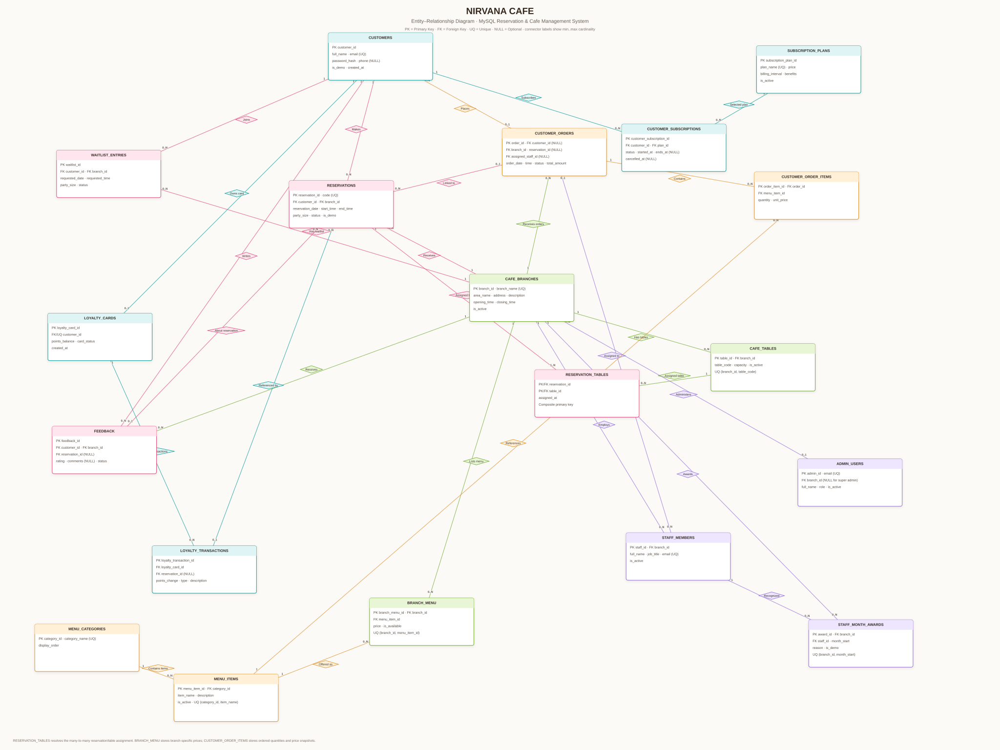
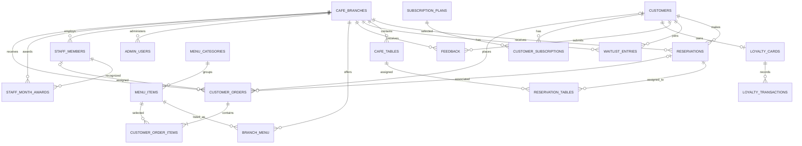

# Nirvana Cafe relational model

This diagram includes customer-facing records and the demo operations extension. Generated staff, awards, and sample orders are synthetic prototype data; no payments are processed.

The schema implements 19 entities. `reservation_tables` is a junction table, so one booking may use multiple tables. `branch_menu` stores price and availability per branch rather than on the shared menu item. Admin accounts are separate from customer accounts; branch admin access is constrained to one branch by the dashboard API.
